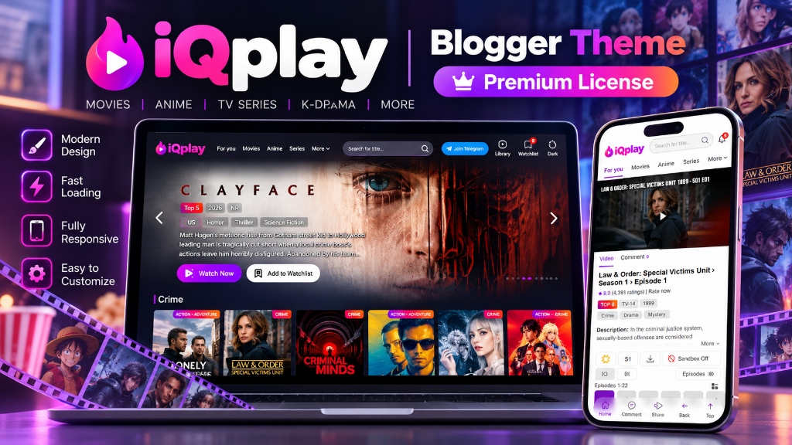

# iQPlay TMDB — Next-Gen Blogger Streaming Theme

<div align="center">



<br><br>

[](https://blogger.com)
[](https://ayengstore.gumroad.com/l/iqplay)
[](https://iqplayofficial.blogspot.com/)
[](https://ayengcoding.github.io/iqplay/)

<p align="center">
  <b>High-performance, dark-slate video on-demand Blogger theme powered by TMDb v3 API, dynamic multi-server failover streaming, Supabase user system & interactive season/episode switcher.</b>
</p>

<!-- Social & Community Connect Buttons -->
<p align="center">
  <a href="https://t.me/ayengcodingofficial" target="_blank">
    
  </a>
  <a href="https://t.me/ayeng_coding" target="_blank">
    
  </a>
  <a href="https://www.facebook.com/acohcayeng" target="_blank">
    
  </a>
  <a href="https://www.instagram.com/acoh_cariel/" target="_blank">
    
  </a>
  <a href="https://github.com/ayengcoding">
    
  </a>
</p>

---

</div>

## 📌 Project Overview

**iQPlay TMDB** transforms any standard Blogger website into a lightning-fast, full-featured streaming portal. By fetching real-time metadata, backdrop backdrops, cast directories, and episode guides on-the-fly via the TMDb REST API, webmasters can run an entire movie and TV series library without heavy database overhead.

- **Theme Name:** iQPlay TMDB
- **Platform:** Blogger (Blogspot XML Engine)
- **Repository:** [https://github.com/ayengcoding/iqplay](https://github.com/ayengcoding/iqplay)
- **Live Documentation App:** [https://ayengcoding.github.io/iqplay/](https://ayengcoding.github.io/iqplay/)
- **Live Demo Site:** [https://iqplayofficial.blogspot.com/](https://iqplayofficial.blogspot.com/)
- **Gumroad Store:** [https://ayengstore.gumroad.com/l/iqplay](https://ayengstore.gumroad.com/l/iqplay)
- **Author:** Ayeng Coding (Ariel O. Mentawan)

---

## 🚀 Key Features

- **TMDb v3 Dynamic Engine:** Automatically loads posters, backdrops, ratings, release years, cast, and episode lists.
- **Multi-Server Streaming Player:** Configured with failover server endpoints (VidSrc, Videasy, VidRock) with dynamic `${id}`, `${season}`, and `${episode}` token substitution.
- **Season & Episode Drawer:** Interactive season dropdown with thumbnail previews and next/previous episode controls.
- **Pure Dark Slate Aesthetics:** Refined `#151821` dark background, `#1c202c` card surfaces, and `#9333ea` purple glow accents.
- **Custom Thin Scrollbars:** Dark `#333c4d` scrollbar tracks on all browsers and devices.
- **User Watchlist & Supabase Comments:** Client-side bookmarking and real-time discussions with avatar selectors (Person, Animals, Animation, Emojis).
- **Sticky Navigation & Horizontal Carousels:** Smooth auto-scrolling rails and responsive drawer navigation for mobile devices.

---

## 1. How to Use & Upload Theme

### Step A: Upload XML Template
1. Open the [Blogger Dashboard](https://blogger.com).
2. Go to **Theme** in the left sidebar.
3. Click the dropdown arrow next to **Customize** and select **Edit HTML** (or click **Restore** and upload `iQplay-premium.xml`).
4. Select all existing code (`Ctrl + A`), delete it, and paste the code from `Product - Ready to Sell/iQplay-premium.xml`.
5. Click **Save** in the upper right corner.

### Step B: Register Domain License
iQPlay is protected with domain-binding licensing:
1. Visit the [Registration Portal](https://abefilmofficialzone.blogspot.com/p/registration-process.html).
2. Register your Blogger domain and your License Key.
3. For free trial keys, check [iQPlay Trial License](https://abefilmofficialzone.blogspot.com/2025/08/iqplay_25.html) or contact [Ayeng Coding](https://t.me/ayengcoding).
> **Note:** Only one domain can be bound per license key.

### Step C: Create Required Static Blank Pages
In Blogger, navigate to **Pages > New Page** and publish the following pages with blank HTML:

| Page Title | Generated URL Slug | Purpose |
| :--- | :--- | :--- |
| **Details** | `/p/details.html` | Movie and series details, cast directory, and season selector |
| **Player** | `/p/player.html` | Streaming video player, server switcher, episode drawer |
| **Library** | `/p/library.html` | Saved bookmarks, personal watchlist, and viewing history |
| **About Us** | `/p/about-us.html` | Site description and about page |
| **Disclaimer** | `/p/disclaimer.html` | DMCA compliance and streaming disclaimer |
| **Privacy Policy** | `/p/privacy-policy.html` | Privacy disclosures and cookies policy |

---

## 2. Layout Guide & Widget Configuration

Configure your site widgets in **Blogger Dashboard > Layout**:

### A. TMDb API Configuration
- **Section:** `tmdb-api-config`
- **Widget:** Add an **HTML/JavaScript** widget with your TMDb v3 API key:
```html
<script>
  window.apiKey = "YOUR_TMDB_V3_API_KEY";
</script>
```

### B. Image Carousel Slider
- **Section:** `image-carousel`
- **Widget:** Add a **Text Widget** with your query:
```text
movie/popular
```
*(Or use `trending/all/day` for daily trending titles)*

### C. Homepage Category Rails
- **Section:** `tmdb-section-1`
- Add **HTML Widgets** where the **Widget Title** is your row header and the **Content** is the TMDb endpoint:
  - **Crime Series:** `discover/tv?with_genres=80&sort_by=popularity.desc`
  - **Action Movies:** `discover/movie?with_genres=28&sort_by=popularity.desc`
  - **Romance Series:** `discover/tv?with_genres=10749&sort_by=popularity.desc`
  - **Anime:** `discover/tv?with_genres=16&with_original_language=ja`

### D. Video Sources & Streaming Servers
- **Section:** `video-sources`
- Supports custom failover servers. The player substitutes `${id}`, `${season}`, and `${episode}` dynamically:
  - **Server 1:** `https://vidsrc.cc/v2/embed/movie/${id}`
  - **Server 2:** `https://player.videasy.net/tv/${id}/${season}/${episode}`

---

## 3. Modular Shortcode Engine

Use modular shortcode blocks to create interactive rails anywhere on your site:

### Carousel No-Wrap (Horizontal Rail)
```html
<div class="tmdb-wrapper" data-label="Popular Movies" data-limit="12">
  <div class="tmdb-header">
    <h3 class="tmdb-title">Popular Movies</h3>
    <div class="tmdb-nav-arrows">
      <button class="tmdb-scroll left">&larr;</button>
      <button class="tmdb-scroll right">&rarr;</button>
    </div>
  </div>
  <div class="tmdb-row nowrap-carousel" data-query="movie/popular"></div>
</div>
```

### Top-10 Ranked Chart
```html
<div class="tmdb-toplist-wrapper" data-label="Top 10 Today" data-limit="10">
  <h3 class="tmdb-title">Top 10 Today</h3>
  <div class="tmdb-top-rank-rail" data-query="trending/all/day"></div>
</div>
```

### Filtered Switcher Tabs
```html
<div class="tmdb-filtered-wrapper" data-label="Explore Content">
  <div class="filter-switch-nav">
    <button class="filter-tab active" data-filter="all">All</button>
    <button class="filter-tab" data-filter="movie">Movies</button>
    <button class="filter-tab" data-filter="tv">TV Series</button>
  </div>
  <div class="tmdb-row" data-query="discover/movie?sort_by=popularity.desc"></div>
</div>
```

---

## 4. Creating a Post (Full HTML View Template)

When publishing custom articles in Blogger, switch the post editor to **HTML view** and paste the universal structure below:

```html
<!-- iQPlay Universal Post Schema -->
<div class="iqplay-post-entry">

  <!-- 1. Backdrop & Poster Images -->
  <div class="iq-hero-art">
    
    
  </div>

  <!-- 2. Primary Video Stream / Embed Iframe -->
  <div class="iq-player-container">
    <iframe id="main-stream-player" src="https://vidsrc.cc/v2/embed/movie/1022789" frameborder="0" allowfullscreen="true" scrolling="no"></iframe>
  </div>

  <!-- 3. Extra Meta Data (JSON Block) -->
  <div id="extra-meta" style="display:none;">{
    "tmdb_id": 1022789,
    "imdb_id": "tt11198330",
    "type": "movie",
    "release_year": "2024",
    "runtime": "100 min",
    "rating": "7.8",
    "quality": "4K Ultra HD",
    "genres": ["Animation", "Family", "Adventure", "Comedy"],
    "synopsis": "Riley faces brand new emotional challenges as Headquarters undergoes a sudden demolition to make room for new emotions."
  }</div>

  <!-- 4. Episodes Multi-Server Data (For Series / Anime) -->
  <div id="episodes-data" style="display:none;">[
    {
      "season": 1,
      "episode": 1,
      "title": "Episode 1: Awakening",
      "servers": {
        "VidSrc": "https://vidsrc.cc/v2/embed/tv/60625/1/1",
        "Videasy": "https://player.videasy.net/tv/60625/1/1",
        "VidRock": "https://vidrock.net/embed/60625-1-1"
      }
    },
    {
      "season": 1,
      "episode": 2,
      "title": "Episode 2: The Encounter",
      "servers": {
        "VidSrc": "https://vidsrc.cc/v2/embed/tv/60625/1/2",
        "Videasy": "https://player.videasy.net/tv/60625/1/2",
        "VidRock": "https://vidrock.net/embed/60625-1-2"
      }
    }
  ]</div>

  <!-- 5. Download Links Data (Multi-Quality) -->
  <div id="download-data" style="display:none;">[
    {"server": "Mega Drive", "resolution": "1080p Web-DL", "size": "2.1 GB", "url": "https://mega.nz/file/sample1"},
    {"server": "Google Drive", "resolution": "720p HD", "size": "950 MB", "url": "https://drive.google.com/file/d/sample2"},
    {"server": "Direct Filer", "resolution": "480p SD", "size": "450 MB", "url": "https://filer.org/dl/sample3"}
  ]</div>

  <!-- 6. Celebrity & Cast Data -->
  <div id="celebrity-data" style="display:none;">[
    {"name": "Amy Poehler", "character": "Joy (voice)", "photo": "https://image.tmdb.org/t/p/w185/AmyPoehler.jpg"},
    {"name": "Maya Hawke", "character": "Anxiety (voice)", "photo": "https://image.tmdb.org/t/p/w185/MayaHawke.jpg"},
    {"name": "Phyllis Smith", "character": "Sadness (voice)", "photo": "https://image.tmdb.org/t/p/w185/PhyllisSmith.jpg"}
  ]</div>

</div>
```

---

## 5. User System, Avatars & Notifications

- **Supabase Cloud Integration:** Built-in connection to Supabase for zero-backend authentication, comment voting, and comment reactions.
- **Avatar Packs Included:** Users can choose profile avatars across 4 categories:
  - *Person:* Clean modern vector avatars
  - *Animal:* Playful animal icons
  - *Animation:* Famous anime & animated personalities
  - *Emoji:* Expressive 3D emojis
- **Floating Toast Center:** Real-time feedback for bookmarking, copying links, and server switches using `showToastNotification(message, type)`.

---

## 6. Community & Socials

Stay connected, get updates, and reach out for assistance:

- **Store License:** [Ayeng Store Gumroad](https://ayengstore.gumroad.com/l/iqplay)
- **Telegram Group:** [@ayengcodingofficial](https://t.me/ayengcodingofficial)
- **Telegram Channel:** [@ayeng_coding](https://t.me/ayeng_coding)
- **Direct Support:** [@ayengcoding](https://t.me/ayengcoding)
- **Facebook:** [acohcayeng](https://www.facebook.com/acohcayeng)
- **Instagram:** [@acoh_cariel](https://www.instagram.com/acoh_cariel/)
- **GitHub:** [@ayengcoding](https://github.com/ayengcoding)

---

<div align="center">
  <b>Developed with passion by Ayeng Coding</b><br>
  <span>© 2026 iQPlay TMDB Theme. All rights reserved.</span>
</div>
