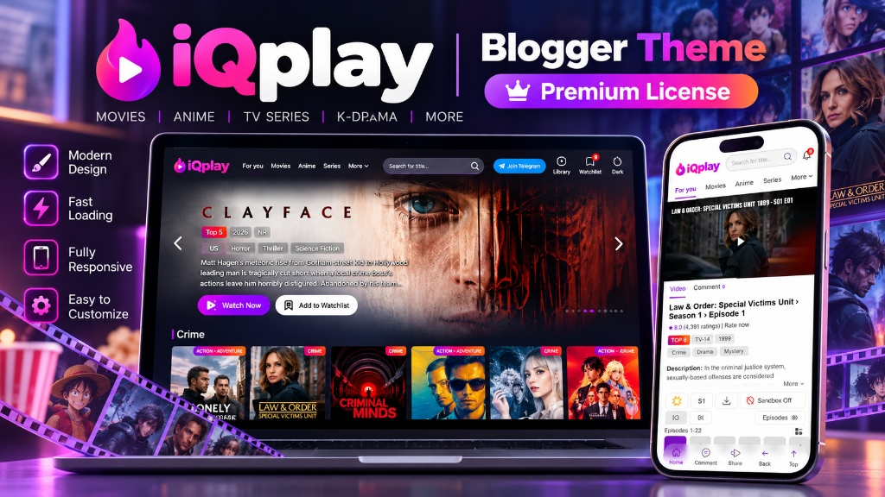

# iQPlay TMDB — Next-Gen Blogger Streaming Theme

  

  <b>High-performance, dark-slate video on-demand Blogger theme powered by TMDb v3 REST API, dynamic multi-server failover streaming, Supabase cloud user system, and interactive season/episode navigation.</b>

<!-- Social & Community Connect Badges -->

  
  
  
  
  

---

## 📌 Project Overview

**iQPlay TMDB** transforms any standard Google Blogger website into a lightning-fast, full-featured video streaming portal. By fetching real-time metadata, backdrop artworks, cast directories, and episode guides on-the-fly via the TMDb REST API v3, webmasters can run an entire movie and TV series library without requiring VPS hosting, heavy SQL databases, or complex server management.

- **Theme Name:** iQPlay TMDB
- **Current Version:** v2.4.0 (Production Stable)
- **Target Platform:** Google Blogger (Blogspot XML Engine)
- **Author:** Ayeng Coding
- **Repository:** [https://github.com/ayengcoding/iqplay](https://github.com/ayengcoding/iqplay)
- **Live Documentation Portal:** [https://ayengcoding.github.io/iqplay/](https://ayengcoding.github.io/iqplay/)
- **Live Interactive Demo:** [https://iqplayofficial.blogspot.com/](https://iqplayofficial.blogspot.com/)
- **Official Store / License:** [https://ayengstore.gumroad.com/l/iqplay](https://ayengstore.gumroad.com/l/iqplay)

---

## 🧭 Interactive Documentation Table of Contents

Navigate the complete developer guide available in the interactive [GitHub Pages Documentation Portal](https://ayengcoding.github.io/iqplay/):

1. **[Get Started](https://ayengcoding.github.io/iqplay/#intro)**
   - [Introduction to Theme Core](https://ayengcoding.github.io/iqplay/#intro)
   - [Quickstart & 4-Step Installation](https://ayengcoding.github.io/iqplay/#quickstart)
   - [Import Demo Posts (feed.atom)](https://ayengcoding.github.io/iqplay/#demo-posts)
   - [Essential Pages Setup (Player, Details, Library)](https://ayengcoding.github.io/iqplay/#essential-pages)
2. **[General Information](https://ayengcoding.github.io/iqplay/#license-system)**
   - [License System & Anti-Theft Domain Lock](https://ayengcoding.github.io/iqplay/#license-system)
   - [Development & Version Changelog](https://ayengcoding.github.io/iqplay/#changelog)
3. **[Dynamic Integrations](https://ayengcoding.github.io/iqplay/#tmdb-config)**
   - [The Movie Database (TMDb) API v3 Engine](https://ayengcoding.github.io/iqplay/#tmdb-config)
   - [Supabase User Accounts & Realtime Watchlist Sync](https://ayengcoding.github.io/iqplay/#supabase-auth)
   - [Multi-Server Failover Video Players](https://ayengcoding.github.io/iqplay/#multi-server)
   - [Realtime Stats, View Counters & Nested Comments](https://ayengcoding.github.io/iqplay/#counter-comments)
4. **[Ecosystem & Tools](https://ayengcoding.github.io/iqplay/#shortcode-builder)**
   - [Interactive Homepage Widget Shortcode Generator](https://ayengcoding.github.io/iqplay/#shortcode-builder)
   - [Blogger Post Schema Creator](https://ayengcoding.github.io/iqplay/#post-creator)
   - [Diagnostic Center & Troubleshooting FAQ](https://ayengcoding.github.io/iqplay/#troubleshooting)
5. **[Community & Support](https://ayengcoding.github.io/iqplay/#community)**
   - [Official Community Channels & Direct Support Contacts](https://ayengcoding.github.io/iqplay/#community)

---

## ⚡ Real Theme Code & Language Stack Breakdown

| Technology / Language | Distribution Badge | Share (%) | Source Lines | Primary Architecture Responsibility |
| :--- | :--- | :---: | :---: | :--- |
| **Modular JavaScript (ES6+)** |  | 62.5% | 3,666 Lines | Client-side TMDb REST fetcher, Supabase authentication client, multi-server video switcher, season/episode router, and local storage caching. |
| **Blogger XML Layout Engine** |  | 20.5% | 1,202 Lines | Templating tags (`<b:includable>`, `<b:widget>`, `<data:post.*>`), conditional page routing, metadata injection, and gadget sections. |
| **CSS3 & Responsive Styles** |  | 17.0% | 994 Lines | Dual light/dark theme variables, fluid CSS grid, sticky 2-tier navigation bars, off-canvas slide drawer, and custom dark scrollbars. |

---

## 🚀 Theme Core Features

- 🎬 **Instant TMDb Metadata Injection:** No manual synopsis typing. Enter a movie or TV TMDb ID and the theme loads posters, backdrops, ratings, release years, cast carousels, and trailers on-the-fly.
- 🔄 **Multi-Server Video Failover:** Built-in support for SuperEmbed, 2Embed, VidSrc, AutoEmbed, plus custom direct MP4/HLS streams (`.m3u8`).
- 🔐 **Supabase Cloud User Engine:** Cloud login and registration allowing visitors to maintain a personalized watchlist and playback history across devices.
- 📱 **Flawless Mobile UX:** Off-canvas slide navigation drawer, touch-swipe subnav pill bar with hidden scrollbars, responsive video players, and live search modal with keyboard shortcuts (<kbd>Ctrl+K</kbd>).
- 🌓 **Dual Light / Dark Mode Engine:** Instant theme switching with auto-persisted preference saved in `localStorage`.
- 🛡️ **Anti-Theft Domain Lock:** Integrated client-side domain authorization preventing unauthorized duplication of your licensed purchase.

---

## 🌐 Connect & Official Community Links

Reach out directly for technical assistance, domain registration approvals, custom modifications, or theme updates:

- **Author Telegram:** [@ayengcoding](https://t.me/ayengcoding) *(Direct Support)*
- **Telegram Broadcast Channel:** [@ayeng_coding](https://t.me/ayeng_coding) *(Announcements & Patches)*
- **Telegram Community Group:** [@ayengcodingofficial](https://t.me/ayengcodingofficial) *(Community Discussions)*
- **Facebook Profile:** [facebook.com/acohcayeng](https://www.facebook.com/acohcayeng)
- **Instagram Profile:** [@acoh_cariel](https://www.instagram.com/acoh_cariel/)
- **GitHub Organization:** [@ayengcoding](https://github.com/ayengcoding)
- **Gumroad Digital Store:** [ayengstore.gumroad.com](https://ayengstore.gumroad.com)

---

## 📄 License & Intellectual Property

Copyright &copy; 2026 Ayeng Coding. All rights reserved.  
Distributed under the official Commercial End User License Agreement (EULA). One license purchase authorizes deployment on one single active public domain name. Commercial resale or redistribution of source files without written authorization is strictly prohibited.
